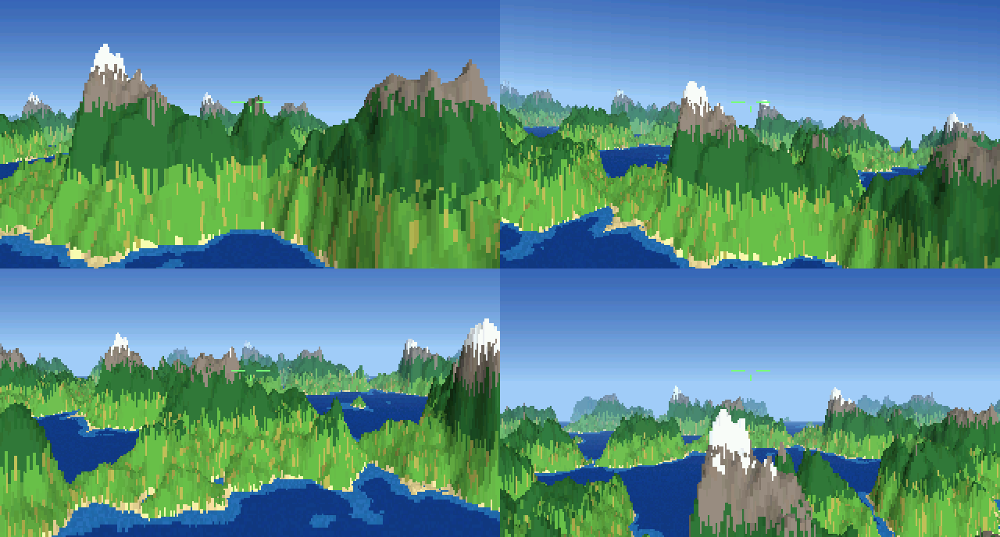

# FlightSim147

A procedurally generated voxel-terrain flight sim (Comanche-style) for the **Waveshare 1.47" ST7789 LCD** (172×320) on ESP32-S3 / ESP32-C6.

- Each boot, or each press of **BOOT**, generates a new 256×256 wrapping island world with lakes, beaches, forest, rock and snow.
- An autopilot banks through turns and follows the terrain. It also has distance fog, a tilted horizon, and an ALT/HDG/FPS HUD.
- Optional analog-joystick steering (`#define USE_JOYSTICK`).

## Flash from your browser (no IDE)
**https://bi0medengr.github.io/FlightSim147/** works in Chrome on Android (v148+) or desktop Chrome/Edge. Plug in the board and tap Install.

The prebuilt merged images are also on the [latest release](../../releases/tag/latest). Flash them at offset `0x0`.

## Build it yourself
1. Install the **esp32 by Espressif** core (3.x) and the **GFX Library for Arduino** (moononournation).
2. Open `FlightSim147/FlightSim147.ino` and choose your board `#define` at the top.
3. ESP32-S3: Tools → USB CDC On Boot → Enabled. Then upload.

## Supported hardware
| Define | Board |
|---|---|
| `BOARD_WAVESHARE_ESP32S3_LCD_147` | Waveshare ESP32-S3-LCD-1.47 |
| `BOARD_WAVESHARE_ESP32C6_LCD_147` | Waveshare ESP32-C6-LCD-1.47 |
| `BOARD_CUSTOM_WIRING` | Bare 1.47" module on any ESP32 (edit pins) |

## Tuning (`flightsim_engine.h`)
- `DIST`: view distance. Lower it for more FPS.
- `HSCALE`: vertical exaggeration.
- `WATER`: sea level.
- `Plane::speed`: cruise speed.

The engine is plain C++ with no Arduino dependencies, so you can compile and test it on a PC.
